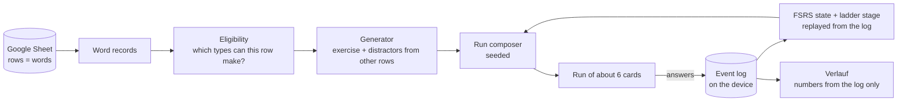

# Engine

How a row of the learner's Google Sheet becomes a run of practice cards, in plain language. Code: `core/src/engine/`, `core/src/exercises.ts`, `core/src/scheduler.ts`. Tests: `core/test/engine.test.ts`, `core/test/dashboard.test.ts`, `core/test/exercises.test.ts`, `core/test/scheduler.test.ts`.

## The idea

The sheet is the only source of content. Every exercise is cut from the columns of one row and from other rows of the same sheet. Nothing is written by hand, nothing comes from an external word list, and a missing column only means fewer exercise types for that row. The app's own state (the event log, settings) lives on the device and never has to be understood to read a word.

## Inputs

| Input | From | Used for |
| --- | --- | --- |
| Word records | Sheet columns (`de`, `en`, `article`, `plural`, `example_*`, `collocation`, `prep`, `note`, `wrong_*`, `domain`, `tier`) | what can be asked, and the distractor pool |
| Event log | device (IndexedDB), synced to the Sheet's `events` tab | FSRS state, ladder stage, confusions, runs, dashboard |
| Settings | device | switched-off types, run length, new cards per run, run gap |
| Seed (string) | the app, per run | tie-breaks only; same inputs and seed give the same run |
| Voice available? | device | Hören is left out without a German voice |

## Eligibility

`exercisesFor(word, allWords, { extended: true })` returns every exercise the row allows. The record needs `de` and `en`, otherwise it yields nothing.

| Type | Needs | Notes |
| --- | --- | --- |
| Karte | `de`, `en` | self-rated, four steps |
| Artikel | noun with `article` | options always der / die / das |
| Plural | noun with `article` and `plural`, 2 other plurals | |
| Bedeutung | 2 other meanings (or `wrong_1/2`) | |
| Lücke | `example_de` containing the form exactly once, 2 other forms | |
| Präposition | `prep` | |
| Kollokation | `collocation` that contains the word itself, 2 other partners | the partner (longest other content word) is blanked |
| Hören | a German voice, 2 other meanings | speaks the example, or the bare word |
| Tippen | `example_de` with the form once | typed, forgiving match |
| Reihenfolge | `example_de` of 4–12 words | tap the words in order |
| Zweiter Kontext | `example_2_de` with its form once, 2 other forms | |

The legacy call (`exercisesFor(w, all)`, no options) still returns only the first eight types in their original order, because they define the ladder's gates.

**Thin rows.** `rowEligibility` / `thinRows` name, for each row, the column whose presence would add exercise types ("Beispielsatz fehlt: gäbe Lücke, Tippen, Reihenfolge"). Settings > Daten shows them as a hint, most to gain first.

## Distractors

Wrong options are always values from other rows of the learner's sheet (`engine/distractors.ts`).

1. **Candidates**: other active rows of the same word class (`pos`), not the same lemma.
2. **Hard rules** (a candidate is dropped, "if unsure, drop it"):
   - equal to the answer, or the same lemma / an inflection (long shared start: *Verspätung* / *Verspätungen*);
   - a synonym: the English glosses share a sense or a content word (*bill, invoice* / *receipt, invoice*); a homonym row (*Bank* = bank / bench) never distracts its twin;
   - already in the sentence;
   - filling the gap with it yields a sentence or collocation the sheet itself contains;
   - for Kollokation: any partner the sheet already pairs with the same word.
3. **Ranking** of what is left: a wrong option the learner chose before for this word (from the log) ranks first; then the same tier, the same topic, the same article, similar length, same first letter, and for forms the same ending, so grammar alone does not decide. Ties break by a seeded hash.
4. **Not enough candidates**: with `fewerOptions` (used for runs) one distractor is accepted (two options); with none, the exercise is not generated and another type is used. Minimum for any choice: two options.

## The ladder

Each word has a stage 0–5 (replayed from the log) and an FSRS-5 memory state (stability, difficulty, last review). The stage decides which types a word may get; the memory state decides when it is due and how hard a variety exercise may be.

| State | Meaning | Exercises |
| --- | --- | --- |
| new (stage 0) | not met, or Karte rated *Nicht gewusst* | Karte |
| building (stages 1–2) | met, not yet secure | Lücke (gate), Artikel, Plural, Bedeutung, Präposition, Kollokation |
| secure (stages 3–5) | production | Tippen (gate), Hören, Zweiter Kontext (gate), Reihenfolge, Kollokation |

- **Gate.** The hardest exercise the row supports at that stage; only a correct gate answer promotes (unchanged from Phase B, so old logs replay identically). The three types added in round 2 never gate.
- **Variety.** Every third review is a non-gate exercise. Its effort is capped by the word's predicted recall now: below 0.6 only recognition (Artikel, Bedeutung, Plural); 0.6–0.85 also in-context choice; above that anything.
- **Run rules.** Never the type just shown in the run, never the word's own last type, when the word's other exercises allow it. If a thin record has nothing for its stage (a small sheet), the Karte is the last resort, so no word is lost.

## Selection of a run

`composeRun` (seeded, pure):

1. Playable words: active, with at least one exercise.
2. **Reviews**: due words first (FSRS due time passed), lowest predicted recall first; then words not due, lowest recall first. Equal recall breaks by a seeded jitter.
3. **New words**: at most *new cards per run* (default 2), in the sheet's order, in a 2/3 core, 1/3 chunk mix. If there are too few words to review, up to one more; a sheet of only new words still fills a run. A large backlog silently pauses new words; the learner never sees a count.
4. **Order**: new cards are spread through the run, never first when a review can open it.
5. **Exercise per card** by the ladder above.
6. A word appears at most once per run. A missed card is not repeated in the same run; FSRS brings it back soon.
7. "Diese üben" (Verlauf) passes chosen words as `focus`: they come first and no new words are added.

A run is *about* six cards (setting, 3–12). The composer returns fewer when the sheet has fewer words.

## Runs in the log

A run is what one `composeRun` produced and the learner worked through. Every event carries the run's id (`payload.run`). Events without one are grouped by an inactivity gap (default 20 minutes, setting). After a longer pause the app drops the unfinished run and starts a fresh one, so the old one counts as a short run. "Noch eine Runde" starts a new run id, so it counts as a second run.

## Grading

| Exercise | Grade |
| --- | --- |
| Karte, four steps the learner picks | *Nicht gewusst* = Again, *Teilweise* = Hard, *Gewusst* = Good, *Sofort* = Easy |
| any choice or typed exercise | wrong or *Weiß ich nicht* = Again; right = Good; right but with help (text shown, near miss) or slower than the type's threshold = Hard |

Easy is never inferred from speed. An experiment with response-time thresholds is not justified without learner data, so the default stays Good (decision recorded in `design/DECISIONS.md`). A new word rated *Nicht gewusst* stays at stage 0, so the Karte returns instead of a quiz it cannot answer.

## What is stored

On the device: the event log (id, time, word, exercise, correct, ms, help, don't-know, chosen option, Karte rating, run id), settings, an audio cache, and the optional audio key. In the Sheet's `events` tab (Phase E sync): the same events; `word_state` is a cache derived from them. Nothing else is stored; every number in Verlauf is recomputed from the log.

## Verlauf numbers

- **Runs / cards** per day and week: from the runs above, assigned to the day the run started.
- **Word states**: *neu* (never met), *im Lernen* (FSRS stability under 21 days), *sicher* (stability 21 days or more, Anki's "mature" line). Stability, not stage, so it matches the memory model.
- **Wörter sicherer**: words whose stability crossed the secure line in that period, found by replaying the log one event at a time.
- **Where it is hard**: words with at least 3 graded answers, 2 misses and a miss share of 25% or more; exercise kinds and topics with at least 8 answers and 25%. Neutral lists with "Diese üben".
- Not computed, by design: streaks, due or overdue counts, forecasts, comparisons.

## Known limits

- Disabling an exercise type that is a gate at some stage (Lücke, Tippen, Zweiter Kontext) means words at that stage are practised with other types but are not promoted until it is switched on again. FSRS scheduling is unaffected.
- The ambiguity guard cannot know meaning: two nouns of the same word class may both fit a sentence. It removes what can be detected (synonyms, inflections, homonyms, phrases the sheet contains) and ranks the rest by similarity.
