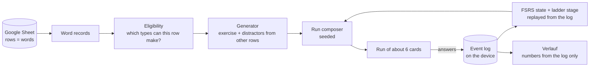

# Engine

How a row of the learner's Google Sheet becomes a run of practice cards, in plain language. Code: `core/src/engine/`, `core/src/exercises.ts`, `core/src/scheduler.ts`. Tests: `core/test/engine.test.ts`, `core/test/dashboard.test.ts`, `core/test/exercises.test.ts`, `core/test/scheduler.test.ts`.

## The idea

The sheet is the only source of content. Every exercise is cut from the columns of one row and from other rows of the same sheet. Nothing is written by hand, nothing comes from an external word list, and a missing column only means fewer exercise types for that row. The app's own state (the event log, settings) lives on the device and never has to be understood to read a word.

## Inputs

| Input | From | Used for |
| --- | --- | --- |
| Word records | Sheet columns (`de`, `en`, `article`, `plural`, `example_*`, `collocation`, `prep`, `note`, `wrong_*`, `domain`, `tier`) | what can be asked, and the distractor pool |
| Event log | device (IndexedDB), synced to the Sheet's `events` tab | FSRS state, ladder stage, confusions, runs, dashboard |
| Settings | device | switched-off types, run length, new cards per run, new words per day, run gap |
| Seed (string) | the app, per run | tie-breaks only; same inputs and seed give the same run |
| Voice available? | device | Hören is left out without a German voice |

## Eligibility

`exercisesFor(word, allWords, { extended: true })` returns every exercise the row allows. The record needs `de` and `en`, otherwise it yields nothing.

| Type | Needs | Notes |
| --- | --- | --- |
| Karte | `de`, `en` | self-rated, four steps |
| Artikel | noun with `article` | options always der / die / das |
| Plural | noun with `article` and `plural`, 2 other plurals | |
| Bedeutung | 2 other meanings (or `wrong_1/2`) | |
| Lücke | `example_de` containing the form exactly once, 2 other forms | |
| Präposition | `prep` | |
| Kollokation | `collocation` that contains the word itself, 2 other partners | the partner (longest other content word) is blanked |
| Hören | a German voice, 2 other meanings | speaks the example, or the bare word |
| Tippen | `example_de` with the form once | typed, forgiving match |
| Reihenfolge | `example_de` of 4–12 words | tap the words in order |
| Zweiter Kontext | `example_2_de` with its form once, 2 other forms | |

The legacy call (`exercisesFor(w, all)`, no options) still returns only the first eight types in their original order, because they define the ladder's gates.

**Thin rows.** `rowEligibility` / `thinRows` name, for each row, the column whose presence would add exercise types ("Beispielsatz fehlt: gäbe Lücke, Tippen, Reihenfolge"). Settings > Daten shows them as a hint, most to gain first.

## Distractors

Wrong options are always values from other rows of the learner's sheet (`engine/distractors.ts`).

1. **Candidates**: other active rows of the same word class (`pos`), not the same lemma.
2. **Hard rules** (a candidate is dropped, "if unsure, drop it"):
   - equal to the answer, or the same lemma / an inflection (long shared start: *Verspätung* / *Verspätungen*);
   - a synonym: the English glosses share a sense or a content word (*bill, invoice* / *receipt, invoice*); a homonym row (*Bank* = bank / bench) never distracts its twin;
   - already in the sentence;
   - filling the gap with it yields a sentence or collocation the sheet itself contains;
   - for Kollokation: any partner the sheet already pairs with the same word;
   - for a chunk whose blank is a whole utterance (three words or more, such as *Habe ich das richtig verstanden?*): no choice cloze at all, because in a dialogue almost any other chunk could fill the gap (found on the real sheet in round 3). The chunk is still typed (Tippen), heard and reordered.
3. **Ranking** of what is left: a wrong option the learner chose before for this word (from the log) ranks first; then the same tier, the same topic, the same article, similar length, same first letter, and for forms the same ending, so grammar alone does not decide. Ties break by a seeded hash.
4. **Not enough candidates**: with `fewerOptions` (used for runs) one distractor is accepted (two options); with none, the exercise is not generated and another type is used. Minimum for any choice: two options.

## Which exercise: evidence per word × type (round 3 default)

Since round 3 the run picks the exercise from the word's own recent answers per exercise type (`chooseByStats`, `config.selector = 'stats'`); the stage ladder below is kept for comparison (`selector: 'ladder'`) and for replaying old logs. Chosen by simulation, see "Choosing the scheduler".

| Level | Types | A word gets here when |
| --- | --- | --- |
| 0 look | Karte | it is new, or a new word was rated *Nicht gewusst* |
| 1 recognise | Bedeutung, Artikel, Plural | it has been met |
| 2 in context | Lücke, Präposition, Wortverbindung, Hören | its last answers at level 1 are mostly right (≥ 60 %, at least one) |
| 3 produce | Tippen, Reihenfolge, Zweiter Kontext | its last answers at level 2 are mostly right |

- "Last answers" = the last four per word and type; *Weiß ich nicht* and *Nicht gewusst* count as wrong.
- After a miss the word steps one level below the missed type. While predicted recall is under 0.5 it stays at recognition.
- Within a level the least-practised type comes first, so a word meets every format its row supports.
- A type the row cannot support is never chosen (it is not generated); a type added later by a new column simply joins its level, without touching the memory state.
- Never the type just shown in the run, and not the word's own last type, when another fits.

## The ladder (round 2, kept for comparison)

Each word has a stage 0–5 (replayed from the log) and an FSRS-5 memory state (stability, difficulty, last review). The stage decides which types a word may get; the memory state decides when it is due and how hard a variety exercise may be.

| State | Meaning | Exercises |
| --- | --- | --- |
| new (stage 0) | not met, or Karte rated *Nicht gewusst* | Karte |
| building (stages 1–2) | met, not yet secure | Lücke (gate), Artikel, Plural, Bedeutung, Präposition, Kollokation |
| secure (stages 3–5) | production | Tippen (gate), Hören, Zweiter Kontext (gate), Reihenfolge, Kollokation |

- **Gate.** The hardest exercise the row supports at that stage; only a correct gate answer promotes (unchanged from Phase B, so old logs replay identically). The three types added in round 2 never gate.
- **Variety.** Every third review is a non-gate exercise. Its effort is capped by the word's predicted recall now: below 0.6 only recognition (Artikel, Bedeutung, Plural); 0.6–0.85 also in-context choice; above that anything.
- **Run rules.** Never the type just shown in the run, never the word's own last type, when the word's other exercises allow it. If a thin record has nothing for its stage (a small sheet), the Karte is the last resort, so no word is lost.

## Selection of a run

`composeRun` (seeded, pure):

1. Playable words: active, with at least one exercise.
2. **Reviews**: due words first (FSRS due time passed), lowest predicted recall first; then words not due, lowest recall first. Equal recall breaks by a seeded jitter.
3. **New words**: at most *new cards per run* (default 2), oldest-added first, then in sheet order, in a 2/3 core, 1/3 chunk mix. A sheet with nothing to review yet gets one extra new card, so a first run is not a single card.

   **New words per day** (setting, default 10, 0–30; release-1, DECISIONS R5-5). A word is new on the day of its first answer (local calendar day). Runs introduce new words until today's count reaches the cap, then none until the next day. The cap does not depend on how many reviews are due: new words get their place in a run even when due words could fill it, and the reviews that do not fit stay due for the next run. 0 means no new words at all. This replaces the earlier "reviews first" room rule and the silent backlog pause; the learner still never sees a count.
4. **Order**: new cards are spread through the run, never first when a review can open it.
5. **Exercise per card** by the ladder above.
6. A word appears at most once per run. A missed card is not repeated in the same run; FSRS brings it back soon.
7. "Diese üben" (Verlauf) passes chosen words as `focus`: they come first and no new words are added.

A run is *about* six cards (setting, 3–12). The composer returns fewer when the sheet has fewer words.

## Runs in the log

A run is what one `composeRun` produced and the learner worked through. Every event carries the run's id (`payload.run`). Events without one are grouped by an inactivity gap (default 20 minutes, setting). After a longer pause the app drops the unfinished run and starts a fresh one, so the old one counts as a short run. "Noch eine Runde" starts a new run id, so it counts as a second run.

## Choosing the scheduler (round 3)

Question: one word has many exercise types; how should they share scheduling? Candidates, all simulated with the real engine code (`core/src/sim/sim.ts`, `node tools/sim.ts`):

- **a** one FSRS state per word; the type is only presentation (uniform over what the row allows)
- **b** one FSRS state per word × type ("facets"), each scheduled on its own
- **ladder** one state per word; the round-2 stage ladder picks the type
- **c0** one state per word decides *when*; per word × type evidence decides *which* (the hybrid)
- **c** c0 plus weighted grades: harder types move the state more (recognition × 0.6, production × 1.25; a production miss is half a lapse)
- **crt** c plus Hard/Easy inferred from response time

**The learner is synthetic.** FSRS-shaped forgetting; each type has a difficulty exponent (recognition easier, typing harder); harder formats give more learning on success; unfamiliar formats are harder at first. These are assumptions, so the results are indicative, not proof. Two runs of six cards a day, 60 days, 20 words added to the sheet on day 30, mean of 5 seeds. "Retention": probability of a right answer at day 60, averaged over recognition, cloze and typing; "known": that probability summed over the words met; "due/day": items the scheduler held due each morning (pressure, never shown); "days to secure": median days until the true memory first lasts 21 days.

60 words (the learner keeps up):

| design | retention | typing | added words | due/day | words met | words known | days to secure | secure at end | look/recognise/context/produce % |
| --- | --- | --- | --- | --- | --- | --- | --- | --- | --- |
| a | 0.90 | 0.84 | 0.89 | 6.4 | 80 | 72.0 ± 1.5 | 48.9 | 4.6 | 21/27/31/21 |
| b | 0.86 | 0.78 | 0.79 | 8.8 | 77 | 66.6 ± 3.2 | 27.3 | 12.4 | 70/11/11/8 |
| ladder | 0.90 | 0.84 | 0.88 | 5.4 | 80 | 72.3 ± 0.9 | 50.2 | 3.4 | 21/44/31/4 |
| c0 | 0.90 | 0.83 | 0.88 | 5.4 | 80 | 71.7 ± 1.1 | 45.2 | 10.6 | 11/27/39/23 |
| c | 0.90 | 0.83 | 0.87 | 5.8 | 80 | 71.8 ± 0.9 | 46.0 | 6.2 | 11/30/41/18 |
| crt | 0.90 | 0.84 | 0.88 | 5.1 | 80 | 72.0 ± 0.3 | 50.5 | 2.6 | 11/32/39/18 |

120 words (more than two short runs a day can hold):

| design | retention | typing | added words | due/day | words met | words known | days to secure | secure at end | look/recognise/context/produce % |
| --- | --- | --- | --- | --- | --- | --- | --- | --- | --- |
| a | 0.85 | 0.76 | – | 8.5 | 91 | 77.4 ± 2.7 | 38.2 | 3.0 | 24/25/31/20 |
| b | 0.86 | 0.77 | – | 8.9 | 81 | 69.4 ± 4.8 | 26.0 | 11.4 | 71/10/11/7 |
| ladder | 0.80 | 0.69 | – | 7.8 | 107 | 85.7 ± 1.9 | – | 0.2 | 27/42/29/2 |
| c0 | 0.81 | 0.71 | – | 8.1 | 100 | 80.9 ± 3.6 | 44.4 | 5.0 | 14/30/37/19 |
| c | 0.82 | 0.71 | – | 7.8 | 100 | 81.2 ± 3.2 | 38.6 | 4.8 | 14/32/39/16 |
| crt | 0.82 | 0.71 | – | 8.0 | 100 | 81.5 ± 3.3 | – | 1.0 | 14/34/37/15 |

("–": the 20 added words were never reached, because reviews come first and new words are introduced oldest-added first; "days to secure –": too few words reached the line.)

**Reading.**
- **b loses** on every count but "secure at end": with a state per facet the same word is reviewed several times over, the load is the highest, fewer words are met and fewer are known. b's "secure" figures come from that over-practice of few words.
- **Weighted grades (c) and response-time grades (crt) bring nothing measurable** over c0: the differences are inside one standard deviation. The full hypothesis (c) therefore does not win; its useful half (one state for *when*, evidence for *which*) does.
- **ladder vs c0.** With a learner who keeps up (60 words) they tie. With more words than time (120), the ladder introduces more words and "knows" about five more, but it almost never reaches production (2 % of cards), its typing score is the lowest, and almost no word becomes secure. c0 spreads practice over all formats (about one card in five is production), gets words secure sooner and still introduces the second-most words.
- **Chosen: c0.** One FSRS memory state per word decides when the word comes back; per word × type evidence decides which exercise; plain FSRS grades. It wins or ties on retention, load, time to secure, spread and mid-way additions (the five criteria of the round-3 brief) and is simpler than c. Recorded in `design/DECISIONS.md` (R3-4).

## Grading

| Exercise | Grade |
| --- | --- |
| Karte, four steps the learner picks | *Nicht gewusst* = Again, *Teilweise* = Hard, *Gewusst* = Good, *Sofort* = Easy |
| any choice or typed exercise | wrong or *Weiß ich nicht* = Again; right = Good; right but with help (text shown, near miss) or slower than the type's threshold = Hard |

Easy is never inferred from speed: the simulation (crt) showed no benefit, so right stays Good. *Weiß ich nicht* is Again, and in the evidence per type it counts as a wrong answer. Grades are not weighted by type (the simulation showed no benefit). A new word rated *Nicht gewusst* stays at stage 0, so the Karte returns instead of a quiz it cannot answer.

## What is stored

On the device: the event log (id, time, word, exercise, correct, ms, help, don't-know, chosen option, Karte rating, run id), settings, an audio cache, and the optional audio key. In the Sheet's `events` tab (Phase E sync): the same events; `word_state` is a cache derived from them. Nothing else is stored; every number in Verlauf is recomputed from the log.

## Verlauf numbers

- **Runs / cards** per day and week: from the runs above, assigned to the day the run started.
- **Letzte 30 Tage**: totals only (runs, cards, words that became secure); shown once there is more than this week.
- **Week chart**: one square per run while no day has more than 8 runs; above that, bars scaled to the busiest day with the number on top (a 200-card day stays readable next to a 1-card day).
- **Word states**: *neu* (never met), *im Lernen* (FSRS stability under 21 days), *sicher* (stability 21 days or more, Anki's "mature" line). Stability, not stage, so it matches the memory model.
- **Wörter sicherer**: words whose stability crossed the secure line in that period, found by replaying the log one event at a time.
- **Where it is hard**: words with at least 3 graded answers, 2 misses and a miss share of 25% or more; exercise kinds and topics with at least 8 answers and 25%. Neutral lists with "Diese üben".
- Not computed, by design: streaks, due or overdue counts, forecasts, comparisons.

## Known limits

- Disabling an exercise type that is a gate at some stage (Lücke, Tippen, Zweiter Kontext) means words at that stage are practised with other types but are not promoted until it is switched on again. FSRS scheduling is unaffected.
- The ambiguity guard cannot know meaning: two nouns of the same word class may both fit a sentence. It removes what can be detected (synonyms, inflections, homonyms, phrases the sheet contains) and ranks the rest by similarity.
