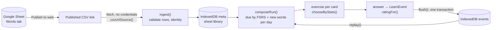
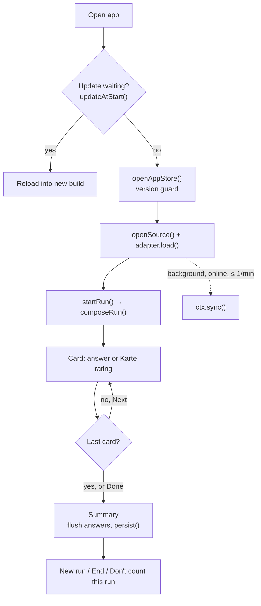
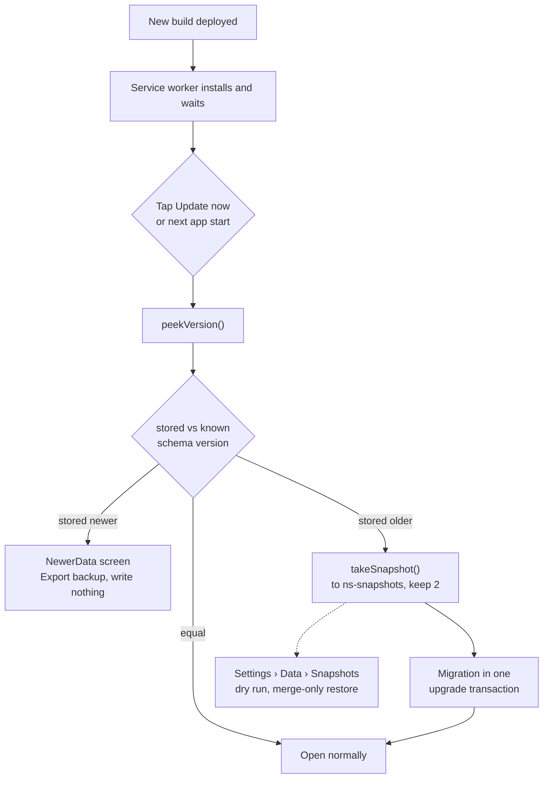
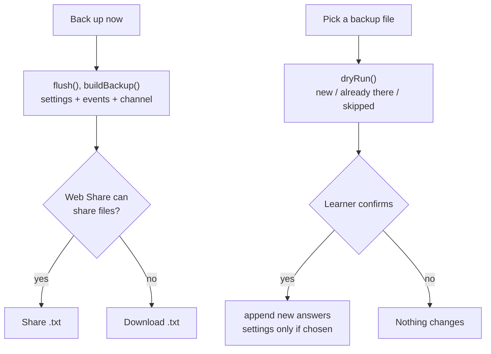
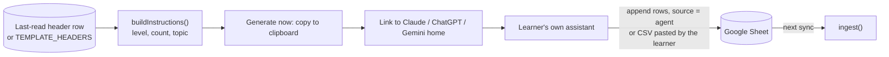
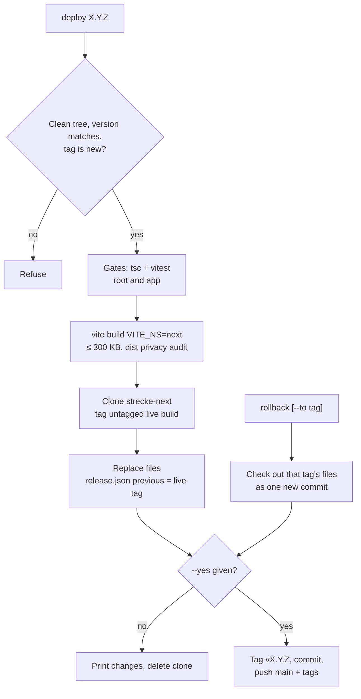

# Flow: the product as graphs

Diagrams of the real code paths on `release-1` (v0.2.0). Each node names the function or file it stands for. Prose and rules: [SPEC.md](SPEC.md).

## a) Data flow

Content comes in read-only from the sheet; answers go only into IndexedDB. FSRS state is never stored: it is replayed from the event log each time a run is composed.

## b) One practice session

From a cold open to the end of a run (`app/src/main.tsx`, `App.tsx`, `run/Run.tsx`). The first card is built from the device only; the sheet sync runs alongside and its new words count from the next run.

Hiding the app also flushes the pending answers; returning after more than the run gap (default 20 min) drops the unfinished run and starts a new one.

## c) Update and migration safety

What happens when a new build arrives (`app/src/state/update.ts`, `app/src/storage/store.ts`, `snapshot.ts`). The waiting worker never takes over by itself; the data check runs before anything is opened for writing.

The migration keeps the old `kv` store, so the pre-migration layout also survives inside the main database.

## d) Backup and restore

Backup is a file the learner keeps; restore only adds answers (`app/src/storage/backup.ts`, `StorageSection.tsx`).

A snapshot from (c) is turned into the same file format (`dumpToBackupText()`) and goes through the same dry run.

## e) AI intake: "Fill my list"

The app only produces text; the assistant and the sheet are outside the app (`core/src/sheet/instructions.ts`, `FillMyList.tsx`). Whether a scheduled assistant can append rows without a human approving each write is unverified.

## f) Release flow (Next channel)

`tools/release.ts`; every command is a dry run unless `--yes` is given. It only writes to the `strecke-next` repository.

No force-push, no history rewrite: a rollback is a new commit and the rolled-back release keeps its tag. Learner data is not part of any of this; it stays in each browser.
